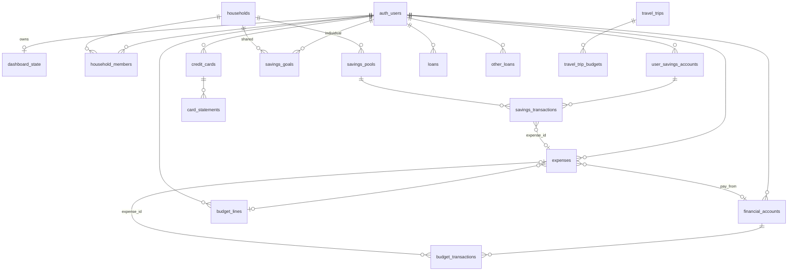

# 05 — Database schema

PostgreSQL schema is defined in [webapp/supabase/migrations/](../webapp/supabase/migrations/) — 74 files, applied **in numeric order**. From 069 on, migrations are tracked with the Supabase CLI; see [Migration process](#migration-process-ops-001) below and [09-development-guide.md](./09-development-guide.md#database-migrations).

All application tables use **Row Level Security (RLS)** unless noted.

---

## Migration index

| # | File | Summary |
|---|------|---------|
| 001 | `001_dashboard_state.sql` | Legacy singleton `dashboard_state` (superseded by 002) |
| 002 | `002_per_user_auth.sql` | Per-user `dashboard_state`; renames 001 → `dashboard_state_legacy` |
| 003 | `003_couples_and_ledger.sql` | Households, savings accounts/pools/goals, `expenses`, RLS helpers |
| 004 | `004_accounts_ledger.sql` | `savings_transactions`, `include_in_savings` flags |
| 005 | `005_financial_accounts_budget.sql` | `financial_accounts`, `budget_transactions` |
| 006 | `006_credit_cards.sql` | `credit_cards` |
| 007 | `007_loans_budget.sql` | `loans`, `budget_lines` |
| 008 | `008_holdings_portfolio.sql` | `holdings`, `portfolio_snapshots` |
| 009 | `009_profile_insurance.sql` | `user_finance_profile`, `insurance_policies`, `ilp_policies` |
| 010 | `010_poker_sessions.sql` | `poker_sessions` |
| 011 | `011_expenses_budget_link.sql` | `budget_line_id` on expenses and budget_transactions |
| 012 | `012_auto_expense_payments.sql` | Auto-payment FKs on `expenses` |
| 013 | `013_recurring_subscriptions.sql` | `recurring_subscriptions`, subscription auto_category |
| 014 | `014_recurring_default_account.sql` | Default pay-from on loans/insurance/ilp |
| 015 | `015_expense_ledger_link.sql` | `expense_id` on savings and budget transactions |
| 016 | `016_income_categories.sql` | `income_categories`; income/poker ledger links |
| 017 | `017_card_statements.sql` | `card_statements`; APR on cards |
| 018 | `018_card_statement_minimum_due.sql` | `minimum_due` on statements |
| 019 | `019_other_loans.sql` | `other_loans` |
| 020 | `020_other_loans_exclude_networth.sql` | `exclude_from_net_worth` |
| 021 | `021_poker_tracker_enhancements.sql` | `poker_locations`, `poker_games`; session fields |
| 022 | `022_other_loans_bt_charge.sql` | Balance transfer charge + expense link |
| 023 | `023_travel.sql` | `travel_trips`, `travel_trip_budgets` |
| 024 | `024_expenses_spent_time.sql` | `spent_time` on `expenses` |
| 025 | `025_transactions_source_links.sql` | `source_record_type` / `source_record_id` on ledger tables |
| 026 | `026_performance_indexes.sql` | Index on `savings_transactions (user_id, occurred_at)` for history views |
| 027 | `027_poker_played_at_timestamptz.sql` | Poker session start stored as `timestamptz` |
| 028 | `028_telegram_integration.sql` | `telegram_links`, `telegram_link_codes`, `telegram_conversations` |
| 029 | `029_expenses_entry_source.sql` | `entry_source` on `expenses` (how the row was created) |
| 030 | `030_other_loan_payment_links.sql` | Allows `source_record_type = 'other_loan'` on `savings_transactions` (loan payment history) |
| 031 | `031_poker_currency.sql` | Poker session currency + FX rate to SGD |
| 032 | `032_poker_tournament_rebuy_bounty.sql` | Tournament rebuys and bounties |
| 033 | `033_travel_splits.sql` | Travel companions, expense splits/shares, settlements |
| 034 | `034_travel_settlement_ledger.sql` | Settlement → cash-account deposit link |
| 035 | `035_savings_goal_start_date.sql` | `start_date` on `savings_goals` |
| 036 | `036_savings_goal_splits.sql` | Per-member monthly `splits` on shared goals |
| 037 | `037_savings_transactions_no_account.sql` | Allows record-only `savings_transactions` rows (no account/pool) |
| 038 | `038_recurring_subscription_end_month.sql` | `end_month` on recurring subscriptions |
| 039 | `039_password_auth_note.sql` | Note only (password auth needs no schema change) |
| 040 | `040_investment_funds.sql` | `investment_funds`, `fund_transactions`; `linked_fund_id` on goals |
| 041 | `041_miles_tracker.sql` | `miles_balances`; `miles_planner` on profile |
| 042 | `042_recurring_subscription_budget_line.sql` | Subscriptions linked to a budget line |
| 043 | `043_recurring_investments.sql` | `recurring_investments`; `investment_id` / `fund_id` on expenses |
| 044 | `044_holding_dividends.sql` | `holding_dividends` |
| 045 | `045_other_loans_monthly.sql` | `monthly` on `other_loans`; `other_loan_id` on expenses |
| 046 | `046_net_worth_snapshots.sql` | `net_worth_snapshots` |
| 047 | `047_cpf_contributions.sql` | `cpf_contributions` (one per user per month) |
| 048 | `048_household_bto_planner.sql` | `household_bto_planner` (shared BTO scenario) |
| 049 | `049_income_category_reimbursement.sql` | Data: "Comms" → "Communication", adds "Reimbursement" category |
| 050 | `050_hidden_flag.sql` | `hidden` on cards, savings accounts and funds (hide instead of delete) |
| 051 | `051_transport_medical_claims.sql` | Data: "Transport Claims" / "Medical Claims" income categories |
| 052 | `052_benefits.sql` | `benefits`, `benefit_claims` |
| 053 | `053_benefits_cycle_dates.sql` | Benefits cycle start/end dates (reverted by 054) |
| 054 | `054_benefits_cycle_frequency.sql` | Benefits back to `cycle_months` + `cycle_anchor_date` |
| 055 | `055_comms_not_baseline.sql` | Data: Communication income is additive, not baseline pay |
| 056 | `056_money_columns_2dp.sql` | Balance columns → `numeric(14,2)` |
| 057 | `057_bnpl_plans.sql` | `bnpl_plans`; `bnpl_id` on expenses |
| 058 | `058_card_statement_bank_total.sql` | `amount_includes_prior_balance` on statements |
| 059 | `059_other_loans_bt_principal.sql` | Balance-transfer principal expense / deposit links |
| 060 | `060_oncall_tracker.sql` | On-call entries, payments, payment items, settings |
| 061 | `061_poker_online_locations.sql` | `is_online` on poker locations |
| 062 | `062_card_statement_reimbursement_credits.sql` | `card_statement_credits` |
| 063 | `063_monthly_budgets.sql` | `budget_months`, `budget_line_months` (see below) |
| 064 | `064_cpf_transactions.sql` | `cpf_transactions` (OA withdrawals/credits, cash BTO payments) |
| 065 | `065_cpf_contribution_date.sql` | `credited_on` on `cpf_contributions` |
| 066 | `066_household_membership_hardening.sql` | SEC-001: drops client insert/update policies on `household_members`; adds `create_solo_household()`, `accept_partner_invite(invite_id)` and a 2-members-per-household trigger |
| 067 | `067_profile_date_of_birth.sql` | FIN-003: nullable `date_of_birth` on `user_finance_profile`; picks age-based CPF rates (null = assume under 35) |
| 068 | `068_monthly_computed_lines.sql` | FIN-005: `monthly_computed_lines` — frozen insurance / ILP / loan-load per finished month (backfilled at today's settings for months before this month; later months are frozen by the month-end job). Months without a row follow live settings |
| 069 | `069_ledger_audit_log.sql` | OPS-002: append-only `ledger_audit_log` + `private.ledger_audit_append()` (see [Ledger functions](#ledger-functions-and-audit-log-069074)) |
| 070 | `070_savings_ledger_functions.sql` | DATA-003: atomic savings ledger functions; `client_request_id` on `savings_transactions` |
| 071 | `071_fund_ledger_functions.sql` | DATA-003: atomic fund ledger functions; `client_request_id` on `fund_transactions` |
| 072 | `072_loan_ledger_functions.sql` | DATA-003: atomic loan / BNPL / other-loan balance changes |
| 073 | `073_expense_ledger_functions.sql` | DATA-003: expense create/delete with ledger effects in one transaction; `client_request_id` on `expenses` |
| 074 | `074_cpf_ledger_functions.sql` | DATA-003: atomic CPF contribution/transaction logging; `client_request_id` on both CPF tables |
| 075 | `075_cpf_reject_negative.sql` | CPF changes that would take OA/SA/MA below $0 are rejected with a clear message instead of floored at 0 (replaces `private.cpf_profile_apply`) |

---

## RLS patterns

| Pattern | Tables | Rule idea |
|---------|--------|-----------|
| **Owner** | Most tables | `user_id = auth.uid()` for ALL |
| **Household member** | `households`, `savings_pools`, shared goals | `is_household_member(household_id)` |
| **Split ledger** | `savings_transactions` | Personal account OR pool membership |
| **Household membership** | `household_members` | Members read their household; a user may read and delete their own row. **No client insert/update** (066) — rows are written only by the `security definer` functions below |
| **Partner invites** | `partner_invites` | Inviter full access, but only for a household they belong to (066); invitee can read/respond to pending invites addressed to their email |

**Helper functions** (003, `security definer`):

- `public.is_household_member(hid uuid)`
- `public.my_household_id()`

**Membership functions** (066, `security definer`, `execute` granted to `authenticated` only):

- `public.create_solo_household()` — creates the caller's solo household and owner membership (idempotent; returns the household id). Used by `ensureUserHousehold` in `lib/household/bootstrap.ts`; the service-role path used when unlinking a partner still inserts directly.
- `public.accept_partner_invite(invite_id uuid)` — in one transaction: locks the invite, checks it is `pending` and addressed to `auth.jwt()->>'email'`, checks the inviter still belongs to the household, moves the caller's membership, marks the invite `accepted` and cancels the caller's own other pending invites. Raises `invite_not_found` / `household_full` / `not_authenticated`. Called by `POST /api/partner/invites/[id]` (`action: accept`) via `lib/household/accept-invite.ts`.
- Trigger `household_members_limit` (`enforce_household_member_limit()`) — rejects a third member (`household_full`), serialised per household with an advisory lock; applies to service-role writes too.

---

## Entity relationship (core)



---

## Tables by domain

### App state

**`dashboard_state`** — `(user_id PK, data jsonb, updated_at)`  
Per-user UI preferences and migration flag `_migrated_v2`. Not the full dashboard anymore.

**`dashboard_state_legacy`** (optional) — Old singleton blob from 001; safe to drop after migration.

### Household

| Table | Key columns | Purpose |
|-------|-------------|---------|
| `households` | `id` | Couple container |
| `household_members` | `household_id`, `user_id` (unique user) | Membership |
| `partner_invites` | `household_id`, `invitee_email`, `status` | Email invites |

### Savings

| Table | Key columns | Purpose |
|-------|-------------|---------|
| `user_savings_accounts` | `balance`, `include_in_savings` | Personal cash jars |
| `savings_pools` | `household_id`, `balance` | Joint pools |
| `savings_goals` | `scope`, `owner_user_id` / `household_id`, targets | Goals |
| `savings_transactions` | `account_id` XOR `pool_id`, `kind`, `amount`, `occurred_at`, `expense_id`, `source_record_*` | Ledger |

### Expenses & budget

| Table | Key columns | Purpose |
|-------|-------------|---------|
| `expenses` | `amount`, `spent_at`, `spent_time`, `category`, `budget_line_id`, `auto_category`, source FKs, `financial_account_id` | Canonical spend |
| `budget_lines` | `category`, `line_type` (`amount` is **deprecated** since 063) | Category catalog — stable ids, name and type shared by all months |
| `budget_months` | `user_id`, `month` (`YYYY-MM`), `monthly_salary` | One header row per month a user has saved a budget for; `monthly_salary` is the gross salary recorded at save time |
| `budget_line_months` | `budget_line_id`, `month`, `amount`, `sort_order` | Per-month amount and order of each category (unique on `budget_line_id, month`) |
| `budget_transactions` | `financial_account_id`, `transaction_type`, `spent_at`, `expense_id`, `import_batch_id` | Card/import ledger |
| `recurring_subscriptions` | `amount`, `deduction_day`, `default_financial_account_id` | Subscription defs |
| `income_categories` | `slug`, `counts_in_baseline`, `counts_as_additive` | Income taxonomy |

### Financial accounts & cards

| Table | Key columns | Purpose |
|-------|-------------|---------|
| `financial_accounts` | `account_type` cash\|credit_card, `savings_account_id`, `card_key` | Pay-from targets |
| `credit_cards` | `card_key`, `statement_day`, `payment_due_day`, `financial_account_id`, rewards json | Card config |
| `card_statements` | cycle dates, `actual_amount`, `amount_includes_prior_balance`, `tracked_amount`, `amount_paid`, `payment_savings_transaction_id` | Billing cycles |

### Debt

| Table | Key columns | Purpose |
|-------|-------------|---------|
| `loans` | `monthly`, `outstanding`, `credit_card_id`, `deduction_day` | Instalment plans |
| `other_loans` | `loan_type`, BT fields, `finance_charge_expense_id`, `exclude_from_net_worth` | Informal / BT loans |

### Investments & profile

| Table | Key columns | Purpose |
|-------|-------------|---------|
| `holdings` | `ticker`, `market`, `qty`, `avg_cost` | Stocks |
| `portfolio_snapshots` | `total_value`, `recorded_at` | History |
| `user_finance_profile` | salary, CPF, `date_of_birth` (067), `bto_planner` jsonb | Planning inputs |
| `monthly_computed_lines` | `month`, `insurance`, `ilp`, `debt` (PK user + month) | Frozen computed lines of finished months (068). Current / future months always use live settings; a finished month with no row falls back to live settings |
| `insurance_policies` | `monthly_premium`, `deduction_day` | Insurance |
| `ilp_policies` | premiums, funds json | ILP |

### CPF ledger

| Table | Key columns | Purpose |
|-------|-------------|---------|
| `cpf_contributions` | `month`, `oa`, `sa`, `ma` (unique per user + month), `credited_on` (065) | Monthly contributions; insert adds to `user_finance_profile.oa/sa/ma`, delete reverses |
| `cpf_transactions` | `txn_date`, `direction` (debit/credit), `funding_source` (cpf_oa/cash), `amount`, `category`, `bto_stage` | OA withdrawals and credits plus cash-paid BTO bills (migration 064). `cpf_oa` rows adjust `user_finance_profile.oa`; cash rows must be BTO debits and never touch CPF. Rows with `bto_stage` reconcile on the BTO planner; the linked partner can read only those (service role, `/api/household/partner-bto-payments`) |

### Poker & travel

| Table | Purpose |
|-------|---------|
| `poker_sessions`, `poker_locations`, `poker_games` | Session tracking |
| `travel_trips`, `travel_trip_budgets` | Trip planning |

### On-call tracker

| Table | Key columns | Purpose |
|-------|-------------|---------|
| `oncall_settings` | `daily_rate`, CPF rates, `cpf_applies`, `default_account_id` | One row per user |
| `oncall_entries` | `start_date`, `end_date`, `daily_rate` | On-call stretches (both dates count) |
| `oncall_payments` | `received_on`, `salary_month`, `amount`, `deposited`, `savings_transaction_id` | Payslip payments |
| `oncall_payment_items` | `payment_id`, `entry_id`, `days` | Days of each stretch a payment covers (partial pay) |

---

## Important link columns

| Column | On | Points to |
|--------|-----|-----------|
| `expense_id` | `savings_transactions`, `budget_transactions` | `expenses.id` — ledger mirror; hidden from unified duplicate streams |
| `source_record_type` + `source_record_id` | ledger tables | Polymorphic link for reimbursements (025) |
| `payment_savings_transaction_id` | `card_statements` | Payment withdrawal row |
| `finance_charge_expense_id` | `other_loans` | One-time BT fee expense |
| `savings_transaction_id` | `oncall_payments` | Income deposit the payment created (null if not deposited or deleted in history) |

---

## TypeScript mappers

DB rows are mapped in domain packages, e.g.:

- [webapp/lib/savings/db-mappers.ts](../webapp/lib/savings/db-mappers.ts) — `mapExpense`, savings tx
- [webapp/lib/credit-cards/mappers.ts](../webapp/lib/credit-cards/mappers.ts) — cards
- [webapp/lib/budget/mappers.ts](../webapp/lib/budget/mappers.ts) — budget transactions
- [webapp/lib/credit-cards/card-statements/mappers.ts](../webapp/lib/credit-cards/card-statements/mappers.ts) — statements

Unified UI type: [webapp/lib/transactions/types.ts](../webapp/lib/transactions/types.ts) (`UnifiedTransaction`).

---

## Ledger functions and audit log (069–074)

Every operation that changes a stored balance runs as **one Postgres function** called with `supabase.rpc(...)`, so the ledger row and the balance change commit or roll back together (DATA-003). Balances move with `balance = balance + delta` under the row lock, so concurrent writes (two tabs, both partners on a pool) can't lose an update. The TypeScript functions kept their signatures and error texts.

| Function (migration) | Replaces | Notes |
|---|---|---|
| `ledger_apply_savings_transaction` (070) | `applyTransaction` | Account or pool balance, goal `saved_amount` (floor 0, as before), ledger row. "Insufficient balance" rolls everything back |
| `ledger_delete_savings_transaction` (070) | `deleteSavingsTransaction` | Row-locked: a double delete reverses once; returns false if not found |
| `ledger_reverse_expense` (070) | `reverseExpenseLedger` | All-or-nothing undo of an expense's withdrawals, record-only rows and card ledger rows |
| `ledger_apply_fund_transaction` / `ledger_delete_fund_transaction` (071) | `applyFundTransaction` / `deleteFundTransaction` | Fund balance + personal goal + ledger row |
| `ledger_adjust_loan_outstanding` / `ledger_adjust_bnpl_months_paid` (072) | `adjustLoanOutstanding` / `adjustBnplMonthsPaid` | Same clamps (outstanding ≥ 0; months 0..tenure) |
| `other_loan_record_payment` / `other_loan_add_draw_down` / `other_loan_restore_*` (072) | `recordOtherLoanPayment` / `addToOtherLoan` / `restoreOtherLoan*` | Expense + withdrawal/deposit + loan totals in one transaction; loan row locked and re-checked |
| `expense_create_with_ledger` (073) | `POST /api/expenses` multi-step | Expense + loan/BNPL/fund + cash withdrawal or card ledger row |
| `expense_delete_with_ledger` (073) | `DELETE /api/expenses/[id]`, unified-list delete | Restores that used to be "log and continue" are still skipped and returned as `warnings` |
| `cpf_add/update/delete_contribution`, `cpf_add/update/delete_transaction` (074) | `lib/cpf/*` | Log row + OA/SA/MA, applied exactly. Since 075 a delete, edit or OA debit that would take a balance below $0 is **rejected** ("This would take your CPF OA below $0 …") and nothing is written, so add-then-delete always returns to the start. Credits and contributions are never blocked |

**Security.** All are `SECURITY INVOKER`: they run as the caller, so RLS still decides what can be touched. Each also checks `p_user_id = auth.uid()` when there is a session (`private.ledger_assert_caller`); the Telegram bot (service role, no `auth.uid()`) passes the linked user's id. `execute` is granted to `authenticated` and `service_role`, revoked from `anon`. Helpers live in the `private` schema, which PostgREST does not expose. The single exception is `private.ledger_audit_append`, which is `SECURITY DEFINER` because API users have no insert right on the audit log; it always records `auth.uid()` when present.

**Idempotency.** `expenses`, `savings_transactions`, `fund_transactions`, `cpf_contributions` and `cpf_transactions` have a nullable `client_request_id` (1–100 chars) with a unique index on `(user_id, client_request_id)`. Create endpoints accept `clientRequestId`; forms send one key per submitted entry ([lib/api/client-request-id.ts](../webapp/lib/api/client-request-id.ts)). A repeat with the same key returns the original row and changes nothing; concurrent repeats are serialised with a transaction-scoped advisory lock. Two-leg transfers derive `<key>:from` / `<key>:to`.

**`ledger_audit_log`** (069): `id, user_id, operation, entity_type, entity_id, delta, balance_after, idempotency_key, details, created_at`. One row per balance moved, written inside the same transaction. RLS: users `select` their own rows; no insert/update/delete policies, privileges revoked from `anon`/`authenticated`; an update trigger blocks edits for every role. Rows go when the user is deleted (`on delete cascade`). Notes are never copied into it.

**Missing function = clear error.** If code is deployed before its migration, [lib/supabase/rpc.ts](../webapp/lib/supabase/rpc.ts) turns PostgREST's `PGRST202` into "The database is missing an update. Run migration 0NN_… in the Supabase SQL editor, then try again."

**Tests.** [webapp/supabase/tests/](../webapp/supabase/tests/) applies every migration to PGlite (default) or a throwaway database on `TEST_DATABASE_URL`, and calls the functions through the real TypeScript wrappers as a signed-in user. With real Postgres (CI `database` job) it also runs the concurrency tests.

---

## Migration process (OPS-001)

Until 068 migrations were pasted into the SQL editor with no record of what ran. From 069 on they are tracked by the Supabase CLI in `supabase_migrations.schema_migrations` on the database. The one-time switch-over and the routine are in [09-development-guide.md](./09-development-guide.md#database-migrations).

Rules for new migration files (enforced by `webapp/supabase/tests/migrations.test.ts`, part of `npm test`):

- Name `NNN_snake_case.sql`, next free number, no gaps or duplicates. **Recheck `main` before merging** and renumber if another PR took the number.
- Re-runnable (idempotent): `create … if not exists`, `create or replace function`, `drop policy/trigger if exists` before `create`, constraints added in a `do $$ … exception when duplicate_object` block. The test re-runs every file from 069 on.
- Additive where possible, so rolling the code back doesn't need SQL.
- Documented in the index above.

---

## Related

- [06-ledgers-and-transactions.md](./06-ledgers-and-transactions.md) — How expense and ledger tables interact
- [08-authentication-and-security.md](./08-authentication-and-security.md) — Auth + RLS usage from the app

---

## Backups

The app has no in-app backup or restore; recovery relies on Supabase's platform backups. In the Supabase dashboard open **Database → Backups**:

- **Scheduled backups** (daily) are available on the Pro plan and above, kept for 7 days on Pro. The Free plan has no downloadable backups.
- **Point in Time Recovery (PITR)** is a paid add-on (Pro or higher) that lets you restore to any second; enable it under **Database → Backups → Point in Time**.
- To restore, use **Restore** on a backup (or a PITR timestamp) on that same page. This replaces the live database, so test it first on a scratch project.

Check the current plan and retention in the dashboard (details change; see Supabase's backup docs).

---

## Household membership hardening (migration 066)

Before 066, RLS on `household_members` let any signed-in user insert or update their own membership row to point at **any** household id (`with check (user_id = auth.uid())`). Anyone who learned a household id (for example from an old invite) could join it and read its shared pools, goals and ledger. 066 removes those two policies, restricts invite creation to the inviter's own household, and moves every join into the two functions above.

**How to apply** (manually, in the Supabase SQL editor):

1. Run `webapp/supabase/migrations/066_household_membership_hardening.sql` **immediately before deploying the matching code**. It is idempotent (`drop policy if exists`, `create or replace`, `drop trigger if exists`), so re-running is safe.
2. Deploy. Until the new code is live, an old build can't create a solo household for a *brand-new* user or accept an invite (the direct inserts are now blocked). Existing users and everything else are unaffected. If the code is deployed first, solo-household creation falls back to the old direct insert until 066 is applied, but invite accept requires 066.
3. Check that no household already has more than two members (the trigger only blocks new joins):

   ```sql
   select household_id, count(*) from household_members group by 1 having count(*) > 2;
   ```

   Any row returned is an unexpected member; investigate and remove it with the service role / SQL editor.

Behaviour notes: accepting an invite leaves the accepter's previous solo household in place with no members (as before); it is not deleted, so its pools and ledger are not cascaded away.

---

## Monthly budgets (migration 063)

`063_monthly_budgets.sql` adds `budget_months` and `budget_line_months` (RLS: `user_id = auth.uid()`) and seeds one baseline snapshot per user, dated the month before the migration runs (Singapore time), from the `budget_lines.amount` values and the profile salary. Run it in the SQL editor immediately before deploying the matching code; running it twice seeds nobody. Rollback of the code needs no SQL because `budget_lines.amount` keeps its rollout-time values.

Known limit: PostgREST returns at most 1000 rows per query, so `budget_line_months` for one user could be truncated after roughly eight years of monthly edits. Not reachable today; a later change can load only the months needed.
